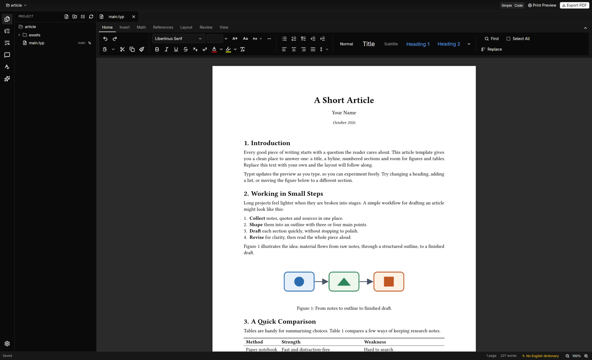

# Folio

Write [Typst](https://typst.app) documents like a word processor or as source code with a live PDF preview. Folio is a native desktop editor. **Simple** mode hides the markup and gives you formatting buttons and document templates. **Code** mode gives you the `.typ` source with completion, diagnostics, and scroll sync. Both modes edit the same files, and you can switch at any time.

Folio compiles documents itself, so it works offline with no separate Typst installation. This repository holds its downloads.

> Folio in Simple mode, editing `main.typ` with the formatting ribbon and live page view.

## Download Folio 0.3.6

| System | Download |
| --- | --- |
| macOS (Apple Silicon) | [Disk image (.dmg)](https://github.com/Turtlezztz/folio-releases/releases/download/v0.3.6/Folio-0.3.6-macos-arm64.dmg) · [Zip](https://github.com/Turtlezztz/folio-releases/releases/download/v0.3.6/Folio-0.3.6-macos-arm64.zip) |
| Windows (x64) | [Installer (.exe)](https://github.com/Turtlezztz/folio-releases/releases/download/v0.3.6/Folio-0.3.6-windows-x64-setup.exe) · [Portable zip](https://github.com/Turtlezztz/folio-releases/releases/download/v0.3.6/Folio-0.3.6-windows-x64.zip) |
| Ubuntu / Debian | [folio_0.3.6-1_amd64.deb](https://github.com/Turtlezztz/folio-releases/releases/download/v0.3.6/folio_0.3.6-1_amd64.deb) |
| Fedora | [folio-0.3.6-1.x86_64.rpm](https://github.com/Turtlezztz/folio-releases/releases/download/v0.3.6/folio-0.3.6-1.x86_64.rpm) |
| Arch Linux | [folio-0.3.6-1-x86_64.pkg.tar.zst](https://github.com/Turtlezztz/folio-releases/releases/download/v0.3.6/folio-0.3.6-1-x86_64.pkg.tar.zst) |
| Other Linux | [Folio-0.3.6-linux-x64.tar.gz](https://github.com/Turtlezztz/folio-releases/releases/download/v0.3.6/Folio-0.3.6-linux-x64.tar.gz) |

Checksums: [SHA256SUMS.txt](https://github.com/Turtlezztz/folio-releases/releases/download/v0.3.6/SHA256SUMS.txt) · Older versions: [Releases](https://github.com/Turtlezztz/folio-releases/releases)

## Two ways to write

- **Simple** is for people who don't know Typst. You edit formatted text on pages with a ribbon, Format and Insert menus, and a start page with a blank document and templates (Letter, Report, Essay, Résumé, Meeting Notes, Newsletter). Anything Simple mode can't show as rich text is kept as it is and shown as a locked box.
- **Code** is the Typst source editor with a live preview beside it.

Folio asks which one you want on first launch. Switch any time with the **Simple | Code** control in the title bar. Because both modes write normal `.typ` files, your documents also open in any other Typst editor.

## What's in it

- **Live preview.** The preview updates as you type and keeps its zoom and position. If the document has an error, the last good preview stays visible and the Problems panel shows where the error is.
- **Formatting and insert commands.** Bold, italic, links, images, figures, tables, citations, references, page breaks, and a Document Style dialog for paper, margins, font and line spacing. Every command is one undo step.
- **Language features.** Completion, hover, go to definition and Format Document, through the Tinymist language service.
- **Spell checking** in more than 50 languages, picked from the document's own `lang` setting.
- **Packages.** Browse and search Typst Universe, install packages, and add the `#import` line with one click. A set of recommended packages can be installed in one go.
- **Calculations.** Calculate, Solve, Simplify, Differentiate, Integrate and more act on the math at the cursor, with the bundled math-once package.
- **Comments** on lines of the document, with a Comments panel to jump between them and resolve them.
- **Export PDF** of exactly what you see, including unsaved changes.
- **Assistant** (optional). A chat about the open project using your Anthropic or OpenAI API key. Its edits show up as changes you accept or reject one by one.
- **External agents** (optional). Connect Claude Code, Codex or another MCP client to the open document. Their edits go through the same review.

## Your files are safe

- Saves are atomic, so a failed save never leaves a half-written file.
- Unsaved work is snapshotted every few seconds. After a crash, Folio offers to restore it.
- Autosave runs two seconds after you stop typing and when the window loses focus. You can change or turn it off in Settings › Files & Saving.
- If another program changes a file you have unsaved edits in, Folio shows the differences and lets you choose. Nothing is overwritten silently.
- Line endings and encodings are kept as they were.

## Privacy

Folio is a local editor. Nothing leaves your computer unless you download a dictionary, package or component, open the Typst Universe catalogue, send a message to the assistant (which goes to the provider you chose), or connect an external agent (which shares the open document with that agent and whatever service it uses).

## What's new in 0.3.6

- **Simple mode works like Word and never shows code.** Pages always match the exported PDF. Content Folio can't edit as text shows as its picture, and a part with a mistake shows a "Couldn't show this part" card you can repair or keep as text. Navigation, search, comments, spelling and the assistant show the text the reader sees.
- **Equations edited on the page.** A Word-like equation editor: type `a/b` for a fraction and press Tab to move between slots, with a structures gallery on the Math tab. The math dialogs use the same field.
- **Captions, cross-references and bookmarks.** Insert Caption, Cross-reference and Bookmark dialogs that list items by their text, with field shading (View › Field Shading) and F9 to update.
- **Tables, styles and properties.** Merge and split cells, cell alignment, table styles and column widths you drag on the page. Modify Style, Document Properties with the template's settings, heading numbering, section breaks and header/footer options. Clicking an object shows its settings in a Properties pane, and Insert › Objects lists built-in objects and add-ins.
- **Word import and export.** Tracked changes in a Word file can be accepted or kept as suggestions. Exported equations are Word equations, and cross-references are Word fields.
- **Join a shared document in the app** by pasting its link. Comments and replies are shared in Simple mode collaboration too.
- **Pasted images are saved into the project.**
- **Smoother scrolling.** Momentum scrolling on touchpads, an animated jump from the preview to the code, and the preview keeps your reading position when you resize or zoom.
- **Vim mode.** Command completion and Folio commands, and yanks and the cursor stay in sync with the system clipboard.
- **Fixes.** Commits without a message, Simple view keeps its scroll position when compiling fails, and Unicode text after an editor sync no longer breaks.

## Install

On first launch Folio offers to download its PDF renderer (PDFium), language service (Tinymist) and the Typst documentation (about 55 MB). You can also do that later in Settings › Components.

**macOS (Apple Silicon):** open `Folio-0.3.6-macos-arm64.dmg` and drag Folio to Applications. Folio is not notarized yet, so macOS blocks it the first time. Go to System Settings › Privacy & Security and click **Open Anyway**.

**Windows (x64):** run `Folio-0.3.6-windows-x64-setup.exe`. The installer is not signed yet, so SmartScreen may show "Windows protected your PC". Click **More info › Run anyway**. `Folio-0.3.6-windows-x64.zip` is a portable copy: unzip it and run `folio.exe`.

**Ubuntu / Debian:** `sudo apt install ./folio_0.3.6-1_amd64.deb`

**Fedora:** `sudo dnf install ./folio-0.3.6-1.x86_64.rpm`

**Arch Linux:** `sudo pacman -U folio-0.3.6-1-x86_64.pkg.tar.zst`

**NixOS / Nix:** `nix run github:Turtlezztz/typst-editor/v0.3.6`, or add the flake's `packages.<system>.folio` (or `overlays.default`) to your configuration. It builds from source and uses Tinymist and PDFium from nixpkgs.

**Other Linux:** unpack `Folio-0.3.6-linux-x64.tar.gz` and run `folio-0.3.6/folio`. The `share/` folder holds a desktop entry and icons for `~/.local/share`.

The Linux packages need glibc 2.39 or newer (Ubuntu 24.04, Fedora 40, Debian 13 or later) and a Vulkan driver (`mesa-vulkan-drivers` on Ubuntu and Fedora, `vulkan-radeon`/`vulkan-intel`/`nvidia-utils` on Arch).

`SHA256SUMS.txt` lists the checksum of every file.
